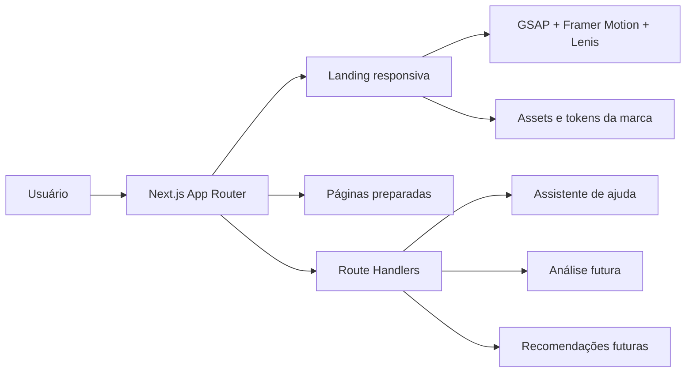

# D’Accord

> **Beleza guiada pela sua pele.** Uma experiência editorial de skincare inteligente que transforma foto, contexto e preferências em escolhas mais claras e coerentes.


## Sobre o projeto

D’Accord é uma plataforma acadêmica de curadoria de skincare. A versão local conecta consentimento, questionário, envio de foto, análise e rotina, produto, sacola, checkout, pedidos do cliente e operação administrativa. A landing apresenta a marca e abre essa jornada.

A integração visual usa a API Perfect Corp v2.1, mediante chave privada e consentimento específico para o envio externo da foto. O modo `mock` continua disponível para ensaios sem chamadas pagas. O catálogo inicial é fictício e o pagamento não realiza cobrança. Veja o [roteiro e os limites da demonstração](docs/DEMO.md).

O projeto traduz o frame oficial do Figma para uma aplicação responsiva em Next.js, preservando a direção editorial da marca e adicionando uma arquitetura pronta para evoluir sem reescrever a landing.

## Destaques

- landing imersiva com seções de `100dvh` e navegação por estágios;
- scroll guiado e suave com Lenis, incluindo uma etapa interna de recomendação;
- animações com GSAP e Framer Motion, respeitando `prefers-reduced-motion`;
- hero em camadas: fundo, modelo HD com transparência real e card editorial;
- composição responsiva específica para desktop e mobile;
- carrossel de passos no mobile para reduzir carga visual;
- chatbot de ajuda integrado à experiência;
- páginas e contratos de API preparados para as próximas fases;
- metadata completa, sitemap, robots, manifest, Open Graph, Twitter Cards e JSON-LD;
- identidade visual ortogonal: cantos retos por padrão em toda a interface.

## Stack

| Camada | Tecnologia | Papel |
| --- | --- | --- |
| Aplicação | Next.js 16 + App Router | SSR, rotas, metadata e APIs |
| Interface | React 19 + TypeScript | componentes e contratos tipados |
| Estilos | Tailwind CSS 4 + CSS responsivo | layout, tokens e direção visual |
| Movimento | GSAP | entrada e composição da hero |
| Transições | Framer Motion | revelações, cards e estados visuais |
| Scroll | Lenis | suavização e navegação por seções |
| Tipografia | Fontsource | fontes locais e estabilidade de renderização |
| Qualidade | ESLint + TypeScript | análise estática e segurança de tipos |
| Backend | Laravel 13 + Sanctum | API, sessões, autenticação e autorização |
| Banco provisório | SQLite | usuários, papéis, sessões e tokens de recuperação |

## Experiência e movimento

O scroll funciona como parte da narrativa da landing:

1. cada seção ocupa a altura útil da tela;
2. um gesto de scroll conduz para o próximo painel;
3. a seção do produto possui um estágio intermediário antes de liberar a próxima seção;
4. transições de opacidade, deslocamento e máscara criam a sensação de mesclagem entre telas;
5. usuários com redução de movimento ativada recebem uma experiência simplificada.

No mobile, a interface evita apresentar todos os passos ao mesmo tempo. O componente `MobileStepDeck` mostra um card por vez, como um baralho editorial navegável.

## Arquitetura



```text
src/
├── app/
│   ├── api/                 # contratos HTTP e assistente
│   ├── analise/             # consentimento e análise por foto
│   ├── questionario/        # perfil e preferências
│   ├── recomendacoes/       # curadoria futura
│   ├── layout.tsx           # metadata global e providers
│   └── page.tsx             # landing + dados estruturados
├── components/
│   ├── landing/             # composição da landing e deck mobile
│   ├── motion/              # scroll e revelações por estágio
│   └── ui/                  # botões, chatbot e componentes compartilhados
├── lib/                     # configuração do site e conteúdo do assistente
└── types/                   # contratos de API

docs/
├── ARCHITECTURE.md
├── BRANDING.md
├── brand-assets/            # fontes e controles de qualidade dos assets
└── preview/                 # imagens usadas na documentação

public/images/               # assets servidos pela aplicação
scripts/                     # utilitários de tratamento dos assets da hero
```

## Rotas

| Rota | Estado | Descrição |
| --- | --- | --- |
| `/` | pronta | landing page principal |
| `/analise` | disponível | introdução e consentimento para a demo autenticada |
| `/questionario?id=…` | disponível | etapas, sinais de alerta, restrições, foto e revisão |
| `/recomendacoes?id=…` | simulação | rotina explicada, lacunas e exclusões |
| `/produtos` | disponível | catálogo completo com busca e filtros |
| `/produtos/[slug]` | disponível | ingredientes, variações, preço e estoque |
| `/sacola`, `/checkout` | demonstração | sacola local, revisão e pagamento simulado |
| `/pedido/confirmado?id=…` | disponível | confirmação do pedido persistido |
| `/conta/pedidos`, `/conta/pedidos/[id]` | autenticada | pedidos da própria conta |
| `/conta/analises` | autenticada | consulta e exclusão das próprias análises |
| `/admin/pedidos`, `/admin/pedidos/[id]` | admin verificado | lista, detalhe e avanço de status |
| `/sobre` | disponível | narrativa institucional |
| `/privacidade`, `/termos`, `/contato` | disponível | funcionamento e limites da demonstração |

## APIs

| Método | Endpoint | Estado | Finalidade |
| --- | --- | --- | --- |
| `GET` | `/api/health` | disponível | verificação de saúde da aplicação |
| `GET` | `/api/help` | disponível | informações e sugestões do assistente |
| `POST` | `/api/help` | disponível | respostas de ajuda sobre o uso da experiência |
| `POST` | `/api/analysis` | substituída (`410`) | informa os novos endpoints autenticados |
| `GET` | `/api/recommendations` | substituída (`410`) | informa a consulta de rotina por análise |
| `GET`, `POST` | `/api/v1/analyses` | autenticada | histórico e registro de consentimento |
| `GET` | `/api/v1/analysis-config` | pública | modo, disponibilidade, versão de consentimento e limites de foto; sem credenciais |
| `GET`, `DELETE` | `/api/v1/analyses/{id}` | proprietário | consulta e exclusão |
| `POST` | `/api/v1/analyses/{id}/submit` | proprietário | respostas, upload e início do processamento assíncrono |
| `GET`, `POST` | `/api/v1/orders` | autenticada | pedidos próprios e compra demonstrativa |
| `GET` | `/api/v1/orders/{id}` | proprietário | detalhe com preços congelados |
| `GET` | `/api/v1/admin/orders` e `/{id}` | admin verificado | operação de pedidos |
| `PATCH` | `/api/v1/admin/orders/{id}` | admin verificado | avanço de status |

Os endpoints `/api/v1/*` pertencem ao Laravel e são acessados pelo navegador via `/backend/api/v1/*`. A criação de pedido usa transação, preços do servidor e uma chave de tentativa para impedir duplicação. Itens sem estoque ou com preço alterado exigem revisão da sacola.

A autenticação funcional está no backend Laravel em `backend/`, sob `/api/v1`. Cadastro, login, logout, consulta da sessão, confirmação de e-mail, recuperação de senha e administração de papéis estão documentados em [docs/AUTH_API.md](docs/AUTH_API.md).

## SEO

A estrutura de SEO está centralizada em `src/app/layout.tsx` e `src/lib/site-config.ts`:

- título, descrição, canonical e palavras-chave em português;
- Open Graph e Twitter Card;
- `robots.txt` e `sitemap.xml` gerados pelo App Router;
- web manifest com identidade D’Accord;
- dados estruturados `Organization`, `WebSite` e `WebPage` em JSON-LD;
- HTML semântico, hierarquia de títulos e textos alternativos;
- fontes locais para reduzir instabilidade visual e dependências externas.

Termos estratégicos usados de forma natural incluem **skincare inteligente**, **análise de pele**, **rotina de skincare personalizada**, **curadoria de cosméticos**, **pele sensível**, **barreira cutânea** e **cosméticos compatíveis**.

> A experiência oferece orientação cosmética e não substitui uma avaliação dermatológica.

## Identidade visual

| Token | Cor | Uso principal |
| --- | --- | --- |
| `--color-plum` | `#2B1924` | texto e fundos de alto contraste |
| `--color-brand` | `#9D286F` | CTAs e grandes áreas de marca |
| `--color-brand-dark` | `#941564` | detalhes e texto de marca |
| `--color-brand-border` | `#B4568C` | contornos e foco |
| `--color-nude` | `#D9B7A7` | blocos editoriais |
| `--color-canvas` | `#FFF0F5` | fundo suave |
| `--color-surface` | `#FFFFFF` | superfícies e contraste |

Tipografia:

- **DM Sans** para navegação, corpo, botões e dados funcionais;
- **Staatliches** para títulos editoriais;
- **Belleza** para a assinatura delicada da marca.

Regra de geometria: o raio padrão é `0`. Botões, cards, imagens, campos, modais e indicadores permanecem com cantos retos, exceto quando houver uma decisão explícita de direção de arte.

Veja todos os fundamentos em [docs/BRANDING.md](docs/BRANDING.md).

## Executar localmente

### Pré-requisitos

- Node.js 20.9 ou superior;
- npm 10 ou superior.

Para a API: PHP **8.4.1 ou superior**, Composer 2 e extensões descritas em [docs/AUTH_API.md](docs/AUTH_API.md). O runtime portátil `.tools/` é uma conveniência deste workspace e não acompanha o clone.

### Instalação

```bash
git clone https://github.com/meumanolevi/daccord.git
cd daccord
npm ci
cp .env.example .env.local
npm run dev
```

No Windows PowerShell, use:

```powershell
Copy-Item .env.example .env.local
```

Acesse [http://localhost:3000](http://localhost:3000).

O painel administrativo está disponível em [http://localhost:3000/admin](http://localhost:3000/admin). Depois de entrar com uma conta de administrador, use:

- `/admin/produtos` para listar, cadastrar, consultar, editar e excluir produtos e variações;
- `/admin/estoque` para consultar disponibilidade, ajustar quantidades e acompanhar o histórico;
- `/admin/pedidos` para consultar os pedidos e avançar o status demonstrativo;
- `/admin/usuarios` para consultar contas e administrar perfis de acesso.

O catálogo público em `/produtos` consome os mesmos produtos e saldos persistidos no SQLite. Cada produto possui uma ou mais variações, e cada variação possui seu próprio registro de estoque.

Para uma instalação nova do backend, com PHP e Composer no `PATH`:

```powershell
cd backend
Copy-Item .env.example .env
composer setup
php artisan serve --host=localhost --port=8000
```

Neste workspace, com o ambiente já preparado, o runtime portátil permite iniciar a API com:

```powershell
cd backend
..\.tools\php\php.exe artisan migrate --seed
..\.tools\php\php.exe artisan serve --host=localhost --port=8000
```

### Preparar a demonstração local

No diretório `backend`, execute `php artisan migrate` e `php artisan demo:prepare --with-order` (ou use `..\.tools\php\php.exe` no lugar de `php`). O comando cria o catálogo inicial, duas contas com e-mail confirmado e um pedido de exemplo: `admin@demo.daccord.test` e `cliente@demo.daccord.test`. Senhas aleatórias são salvas em `backend/storage/app/private/demo-credentials.json`, ignorado pelo Git. Contas existentes mantêm suas senhas e permissões; produtos existentes mantêm seus preços, edições e saldos. O pedido de exemplo baixa uma unidade de estoque apenas na primeira execução. Omita `--with-order` para preparar apenas catálogo e contas.

O comando só funciona em ambientes `local` e `testing`. Os seis produtos iniciais e suas composições são fictícios; os ingredientes ficam com revisão pendente e só são aceitos como fixtures pelo motor nesses ambientes. Não representam validação de segurança ou ficha técnica de fabricante. O e-mail de desenvolvimento usa log; as contas da demo dispensam recebimento de mensagem para entrar.

Configure o PHP com `upload_max_filesize=5M`, `post_max_size=8M` e um `upload_tmp_dir` gravável. Neste workspace, o runtime portátil já foi ajustado. A limpeza de análises expiradas está agendada por hora; execute `php artisan schedule:work` para mantê-la ativa ou `php artisan analyses:purge` para uma limpeza manual.

Com frontend e API rodando, `node scripts/check-demo.mjs` valida a jornada pela API real através do proxy, cookies e CSRF. Cada execução cria uma análise e um pedido de teste, baixa uma unidade e avança o pedido para preparação. O script repete a mesma compra para conferir que não duplica pedido nem estoque. Essa verificação não substitui o ensaio visual no navegador.

### Ambiente

```env
NEXT_PUBLIC_SITE_URL=http://localhost:3000
NEXT_PUBLIC_API_URL=http://localhost:8000
BACKEND_INTERNAL_URL=http://localhost:8000
```

As chamadas do navegador para `/backend/*` são encaminhadas pelo Next.js ao Laravel. Esse proxy mantém a autenticação funcional quando o frontend é aberto por `localhost`, `127.0.0.1` ou pelo endereço da rede local.

Em produção, defina `NEXT_PUBLIC_SITE_URL` com o domínio canônico para gerar URLs corretas em metadata, sitemap e dados estruturados.

## Scripts

| Comando | Ação |
| --- | --- |
| `npm run dev` | inicia o ambiente de desenvolvimento |
| `npm run build` | gera o build otimizado de produção |
| `npm run start` | executa o build de produção |
| `npm run lint` | valida padrões de código |
| `npm run typecheck` | verifica os tipos sem emitir arquivos |
| `npm test` | executa todos os testes Node de tipografia, carrossel, paginação e sacola |
| `npm run test:e2e:setup` | prepara a gravação do Playwright, usando o Chrome instalado |
| `npm run test:e2e` | testa a jornada real em desktop, tablet e celular; grava os vídeos |
| `npm run demo:artifacts` | reúne capturas e vídeos de uma execução aprovada em uma galeria local |
| `npm run test:pagination` | verifica carregamento completo do catálogo e falha entre páginas |

## Qualidade e acessibilidade

Antes de abrir um pull request:

```bash
npm run lint
npm run typecheck
npm run build
```

Cuidados já incorporados:

- foco visível e navegação sem dependência exclusiva do mouse;
- labels e regiões com nomes acessíveis;
- `prefers-reduced-motion` para reduzir animações;
- layout sem rolagem horizontal nos breakpoints testados;
- imagens prioritárias e carregamento tardio das imagens abaixo da dobra;
- contratos de API tipados e limites básicos de entrada no chatbot.

## Pipeline da hero

A modelo da hero foi extraída novamente da fonte original do Figma em resolução integral. O asset final possui fundo transparente, cabelo reconstruído no topo e composição separada do background.

- asset de produção: `public/images/hero-model-hd-v13.png`;
- fonte e comparações: `docs/brand-assets/hero-recut-v13/`;
- script reprodutível: `scripts/build-hero-model-v13.py`.

O script requer Python 3.11+ com Pillow, NumPy e SciPy. Os assets finais já estão versionados, portanto esse passo não é necessário para executar a aplicação.

## Próximas etapas

- validar a conexão ao vivo e um resultado visual com a chave e os créditos da conta Perfect Corp;
- substituir composições fictícias por dados revisados de produtos reais;
- integrar pagamento, frete e cancelamento reais;
- ampliar perfil, privacidade e operações da conta;
- ensaiar a apresentação falada no computador da entrega, usando os vídeos técnicos como reserva;
- acrescentar CI e ampliar a cobertura automatizada de navegador;
- validar Core Web Vitals e acessibilidade em ambiente publicado;
- definir observabilidade, analytics e estratégia de experimentação.

## Documentação complementar

Para configurar a Perfect Corp sem editar o `.env`, abra `configurar-perfectai.cmd` na pasta do projeto. O assistente solicita a chave em campo oculto e a valida antes de salvar. A chave deve ser obtida no painel da sua própria conta Perfect Corp. Detalhes de consentimento, processamento, limpeza e testes em [DEMO.md](docs/DEMO.md#integração-perfect-corp-v21).

- [Arquitetura](docs/ARCHITECTURE.md)
- [Branding](docs/BRANDING.md)

---

Construído para transformar dúvida em um ritual de skincare mais coerente — **D’Accord com a sua pele**.
